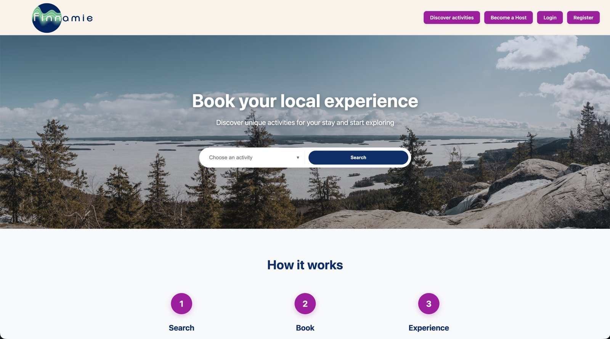

# Finnamie – Frontend

Web app for **Finnamie**, a startup where tourists find and book experiences hosted by locals around Finland. Built as a Metropolia UAS innovation project by a team of four.

Backend: [finnamie-projekti-backend](https://github.com/Mihuy1/finnamie-projekti-backend)



## Features

- **Discover** – browse experiences on an interactive map (Leaflet, clustered markers) or as a list
- **Booking** – pick a timeslot from the host's calendar and pay with Stripe
- **Accounts** – separate sign-up flows for travellers and hosts, email verification
- **Host tools** – create and edit experiences, upload images, manage timeslots
- **Chat** – real-time messaging between travellers and hosts (Socket.IO)
- **Reviews** – rate and review completed experiences
- **Admin** – admin view for managing content

## Tech stack

React 19 · Vite · React Router · Leaflet / react-leaflet · Socket.IO client · react-calendar · react-hot-toast

External APIs: Geoapify (geocoding), Pexels (images), Stripe (payments, via the backend)

## Getting started

### Prerequisites

- Node.js 20+
- The [backend](https://github.com/Mihuy1/finnamie-projekti-backend) running locally (default `http://localhost:3000`)

### Install and run

```bash
git clone https://github.com/Mihuy1/finnamie-projekti-frontend.git
cd finnamie-projekti-frontend
npm install
```

Create a `.env` file in the project root:

```env
VITE_BACKEND_BASEURL=http://localhost:3000/   # trailing slash required
VITE_GEOAPIFY_KEY=your_geoapify_key
VITE_PEXELS_API_KEY=your_pexels_key
```

Then start the dev server:

```bash
npm run dev
```

The app runs at `http://localhost:5173`.

### Scripts

| Command           | Description                  |
| ----------------- | ---------------------------- |
| `npm run dev`     | Start the dev server         |
| `npm run build`   | Production build to `dist/`  |
| `npm run preview` | Preview the production build |
| `npm run lint`    | Run ESLint                   |

## Project structure

```
src/
├── Pages/       # Route-level views (Home, Discover, BookActivity, Profile, Admin…)
├── components/  # Reusable UI (Map, Chatbox, TimeslotSelector, ReviewModal…)
├── api/         # apiClient.js – all REST calls to the backend
├── auth/        # Auth context and provider
├── contexts/    # Chatbox context
├── hooks/       # Custom hooks (useUserProfile)
├── utils/       # Date helpers, Leaflet config
├── data/        # Static data (Finnish municipalities)
└── socket.js    # Socket.IO client
```

## Team

Built by Patrik Hyytiäinen, Sara Pappila, Mikael Asikainen and Abdullahi Ali for Finnamie as part of Metropolia's innovation project course.
